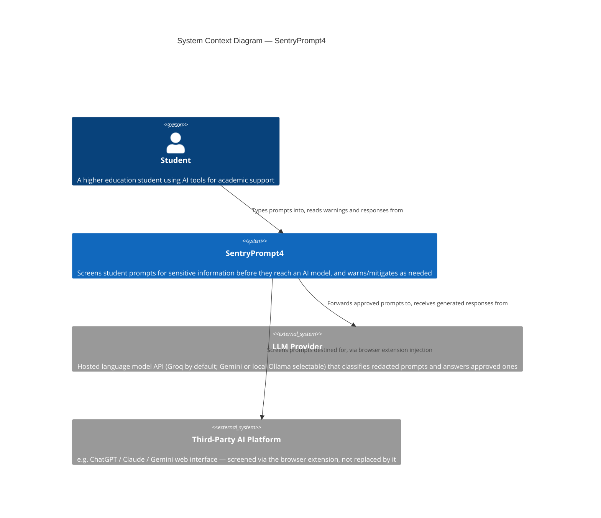
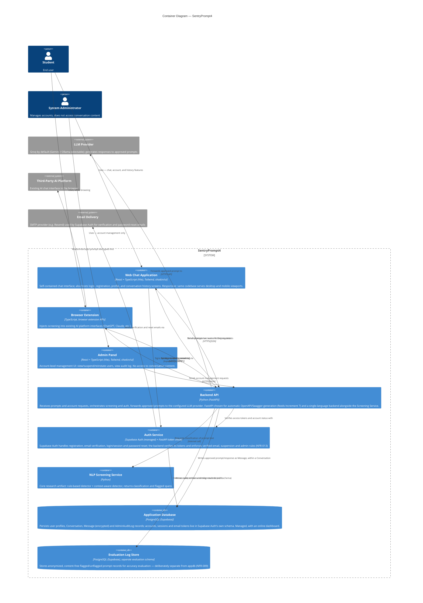
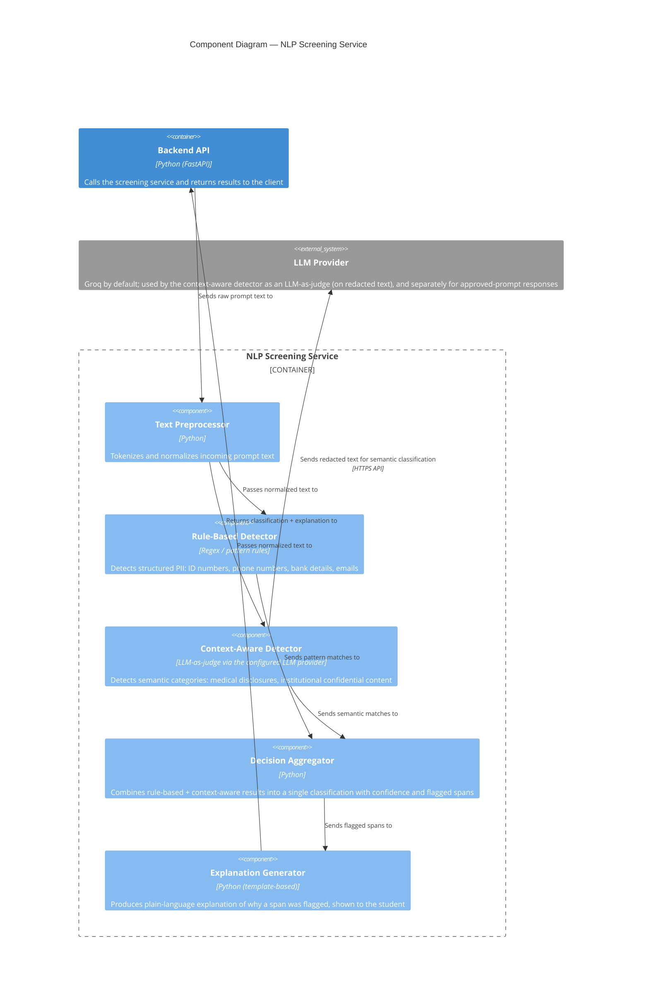

# ARCHITECTURE.md

## Project Title
**SentryPrompt4** — Context-Aware NLP Screening for Sensitive Information in Higher Education AI Prompts

## Domain
Higher Education Technology / Data Privacy & AI Safety — see [../requirements/SPECIFICATION.md](../requirements/../requirements/SPECIFICATION.md) for full domain description.

## Problem Statement
Students unknowingly expose sensitive personal and institutional data in AI prompts, with no interception mechanism in place before transmission to a third-party model. See [../requirements/SPECIFICATION.md](../requirements/../requirements/SPECIFICATION.md) for the complete problem statement and POPIA context.

## Individual Scope & Feasibility
Research prototype expanded to a full account-based platform (registration, login, persistent conversation history, admin panel) alongside the core screening research; one shared backend consumed by two thin client surfaces (web app, browser extension); a hosted LLM reached through a provider interface (Groq by default) lets the app run when deployed, without a local model install. See [../requirements/SPECIFICATION.md](../requirements/../requirements/SPECIFICATION.md) §1.3 for full justification and the accepted feasibility trade-off.

---

## C4 Model

This project follows the [C4 model](https://c4model.com/): Context → Containers → Components, going from the broadest system view down to internal design.

### Level 1: System Context Diagram

Shows SentryPrompt4 as a single system in relation to its users and external dependencies.



**Key point for this diagram:** SentryPrompt4 does not replace the AI model or the student's preferred platform — it mediates access to them, consistent with the "browser vs. internet" analogy in the specification.

---

### Level 2: Container Diagram

Shows the major deployable/runnable units inside SentryPrompt4 and how they communicate. Both client surfaces are thin — all screening logic lives once, in the Screening Service.



**Design note:** Because both client surfaces still call the same Backend API and Screening Service, the platform expansion adds two new containers (Auth Service, Admin Panel) and a database, but does not duplicate the research logic — the screening pipeline is unchanged and remains the single source of truth for detection, exactly as before.

---

### Level 3: Component Diagram — NLP Screening Service

Zooms into the Screening Service, which is the actual research contribution of the project.



**Research note:** The Rule-Based Detector and Context-Aware Detector run independently and both feed the Decision Aggregator. This is intentional — running both on every prompt (rather than only falling back to context-aware when rules miss) is what enables the precision/recall comparison described in ../requirements/SPECIFICATION.md §6.

**Gap closed from Increment 2A:** the original diagram had only one entry point into the Screening Service (via the live Backend API), but FR-012 requires evaluation to run independent of live usage. An **Evaluation Harness** (a standalone script, not shown as a separate C4 component since it is a research tool rather than a deployable service) calls the Screening Service's `preprocessor` directly using the same interface the Backend API uses, bypassing `api`, `webapp`, and `extension` entirely. This is the mechanism behind UC8 in ../requirements/USE_CASES.md.

---

## End-to-End Component Summary

| Layer | Component | Responsibility |
|---|---|---|
| Client | Web Chat Application | Primary UI — chat, login/registration, profile, conversation history |
| Client | Browser Extension | Screens prompts on third-party AI platforms in place |
| Client | Admin Panel | Account-level management UI; no conversation-content access |
| Service | Backend API | Orchestration, routing between clients, screening, auth, and the LLM provider |
| Service | Auth Service | Registration, verification, login/session, password reset |
| Service | NLP Screening Service | Core research logic — detection, aggregation, explanation |
| Data | Application Database | Persists User/Session/Conversation/Message (encrypted)/AdminAuditLog |
| Data | Evaluation Log Store | Content-free, supports accuracy/false-positive evaluation — deliberately separate from Application Database |
| External | LLM Provider | Groq by default (Gemini or local Ollama selectable via `LLM_PROVIDER`) — classifies redacted prompts and generates responses to approved prompts |
| External | Third-Party AI Platform | Existing tool the extension screens prompts for, without replacing it |
| External | Email Delivery | Sends verification and password-reset emails |

## Tech Stack Decision (revised for deployment)

**Revision note:** the first version of this stack (React/Vite, FastAPI, SQLite, local Ollama, no Docker) was chosen for a project that would only ever run on one development machine. Once deployment became a goal, three of those choices stopped fitting: a SQLite file is lost when a hosting platform restarts or redeploys the server, a local Ollama model requires every server to have Ollama installed, and authentication built from scratch is a large amount of security-sensitive code for a solo project. The stack below replaces them. The research core (two detectors in parallel, compared on the test set) is unaffected.

| Layer | Choice | Why |
|---|---|---|
| Web Chat Application, Admin Panel | React + **TypeScript** (Vite), Tailwind CSS, **shadcn/ui** components | One responsive codebase for desktop and mobile. TypeScript catches errors before runtime; shadcn/ui gives accessible, ready-made components (forms, dialogs, tables) instead of hand-building them. Builds to static files that free static hosts serve. |
| Backend API, Screening Service | Python (FastAPI), async | Same language as the screening and evaluation code. Async lets the rule-based and context-aware detectors run concurrently (FR-004) without blocking other requests. FastAPI generates OpenAPI/Swagger documentation automatically (Increment 7). Tooling: `uv` for dependencies, Pydantic for validation, SQLAlchemy 2 + Alembic for database access and migrations. |
| Application Database | **PostgreSQL, hosted on Supabase** | Relational, which matches the 14-entity ERD, its 3NF normalisation and the account-deletion cascade (NFR-014) directly. Supabase provides an online dashboard (table browser, SQL editor, logs) and a free tier (2 projects, 500 MB each) that covers this project. Because it is standard PostgreSQL, the data can move to any other Postgres host without code changes. *Replaces SQLite (local file, lost on redeploy) — see revision note.* |
| Evaluation Log Store | Same Supabase Postgres instance, separate `evaluation` schema | Still kept apart from application data (NFR-009): separate schema, no foreign keys to user tables, content-free by design. |
| Authentication | **Supabase Auth**, verified by the FastAPI backend | Handles registration, email verification, login, logout, password reset and password hashing (bcrypt). The frontend signs in with `supabase-js`; the backend checks the resulting token on every request and applies its own rules (verified email, account not suspended, admin role). See AUTH_DESIGN.md §0. *Replaces a custom-built auth service.* |
| Email delivery | Supabase Auth emails, sent through a custom SMTP provider (e.g. Resend) for real users | Supabase's built-in email sender is only for testing (heavily rate-limited), so a free-tier SMTP provider is configured before real students sign up. |
| LLM | Groq API by default (`llama-3.1-8b-instant`), behind a provider interface; Gemini and Ollama selectable with `LLM_PROVIDER` | No local install needed, fast enough for NFR-010, and its terms prohibit training on API data, so it can receive real student prompts after local redaction (NFR-008). Gemini is for development and demos only (its free tier may train on data); Ollama is kept for offline evaluation. Implemented in `backend/app/llm/`. |
| Browser Extension | TypeScript, browser extension APIs | Chrome/Firefox extensions require JavaScript (TypeScript compiles to it); a platform constraint, not a stack preference. |
| Hosting (at deployment) | Frontend on a free static host (e.g. Vercel, Netlify, Cloudflare Pages); backend as a Docker container on a platform such as Render, Railway or Fly.io | Exact hosts are chosen at deployment time, after checking current free tiers. The `Dockerfile` keeps the backend portable between them. |
| Secrets | `.env` locally (never committed); the host's secret settings in deployment | Holds the Supabase keys, database URL, Groq key and the message-encryption key (NFR-011). |
| Quality and security checks | GitHub Actions on every push and pull request: ruff (lint, formatting, Bandit security rules), mypy (strict type checking), pytest, pip-audit (known vulnerabilities in dependencies); dependencies locked in `uv.lock` | Catches errors and vulnerable dependencies before they reach `main`; enforces SECURITY_RULES.md §6–§7 automatically. |

### Setup & Deployment (NFR-004)

**Local development** (documented in `backend/README.md` and, later, `frontend/README.md`):

```bash
# Backend
cd backend
uv sync                       # installs Python dependencies
cp .env.example .env          # add Supabase URL/keys, DATABASE_URL, GROQ_API_KEY
uv run alembic upgrade head   # creates/updates the database tables
uv run fastapi dev app/main.py

# Frontend
cd frontend
npm install
npm run dev
```

Development uses its own Supabase project (the free tier allows two: one for development, one for the deployed app), so nothing needs to be installed locally except Python and Node.js.

**Deployment:** the backend is built from a single `Dockerfile` and run on the chosen host with the same environment variables set as secrets; the frontend is built with `npm run build` and the static output uploaded to the static host. Database changes are applied with `alembic upgrade head` as part of each deployment.

**Revision note:** the earlier design rejected Docker as unnecessary for a single-machine prototype. For deployment it is the most portable option, since nearly every hosting platform runs a container, so it is now part of the design. Neither the local setup nor the deployment has been tested end to end yet; that is build-phase work.

---

## Links
- [README.md](./README.md)
- [../requirements/SPECIFICATION.md](../requirements/../requirements/SPECIFICATION.md)
- [../requirements/REQUIREMENTS.md](../requirements/../requirements/REQUIREMENTS.md)
- [DOMAIN_MODEL.md](DOMAIN_MODEL.md)
- [AUTH_DESIGN.md](AUTH_DESIGN.md)
- [ERD.md](ERD.md)

---