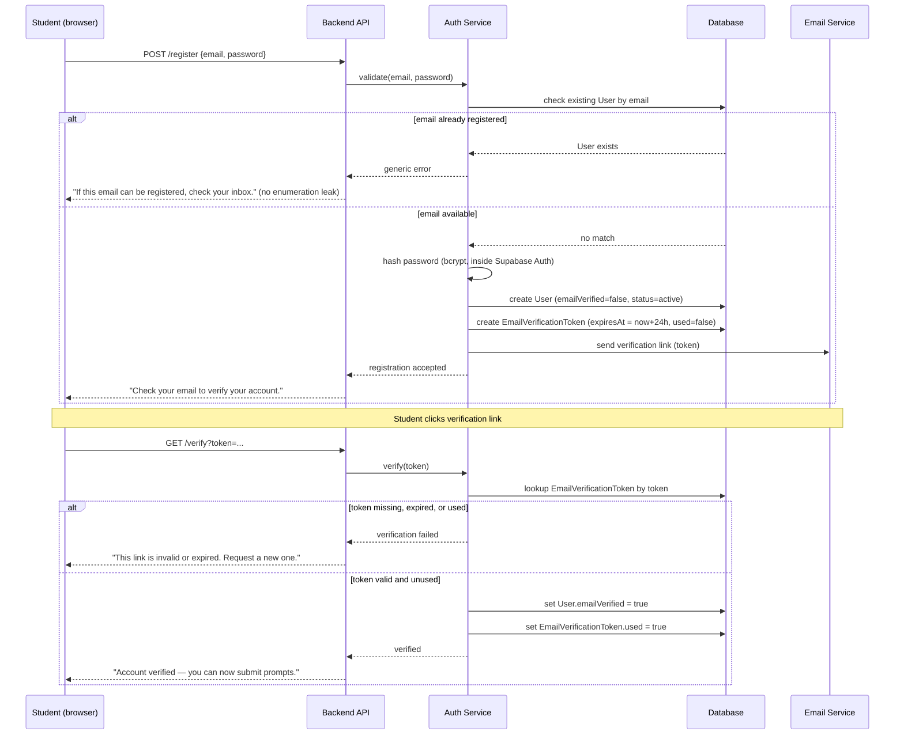
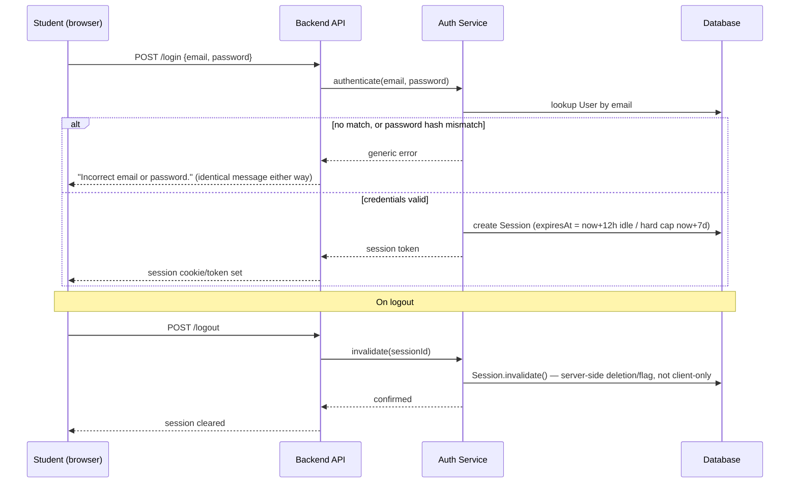
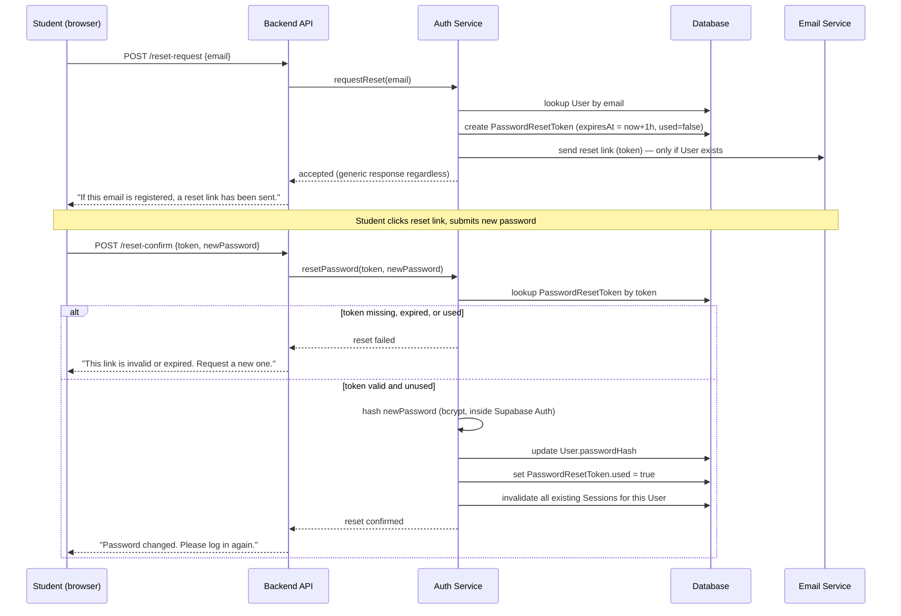

# AUTH_DESIGN.md — SentryPrompt4

**Increment:** 4B — Auth & Account Module Design
**Traces to:** FR-013–FR-018, FR-021, FR-022, NFR-011, NFR-012, NFR-013, NFR-014 (../requirements/REQUIREMENTS.md); `User`, `Session`, `EmailVerificationToken`, `PasswordResetToken` (DOMAIN_MODEL.md §5)

This document specifies the concrete flows behind the Auth Service container already present in ARCHITECTURE.md and the entities already defined in DOMAIN_MODEL.md. It does not introduce new scope — every decision below resolves an ambiguity that was already implied but not yet pinned down (e.g. DOMAIN_MODEL.md defines `EmailVerificationToken.expiresAt` as an attribute, but no document yet states what that expiry window actually is).

---

## 0. Implementation: Supabase Auth (revised for deployment)

The flows in §2–§4 describe the required **behaviour**. They are implemented with **Supabase Auth** rather than a custom-built auth service, so the "Auth Service" participant in the diagrams below is Supabase Auth, and the `Session`, `EmailVerificationToken` and `PasswordResetToken` entities are stored in Supabase's own `auth` schema rather than in tables we create.

| Responsibility | Who does it |
|---|---|
| Registration, email verification, login, logout, password reset (FR-013–FR-017) | Supabase Auth, called from the frontend with `supabase-js` |
| Password hashing (NFR-012) | Supabase Auth (bcrypt). Our backend never sees or stores a password hash |
| Verification and reset emails | Supabase Auth, through a custom SMTP provider for real users (ARCHITECTURE.md) |
| Checking every API request | FastAPI backend: verifies the Supabase access token (JWT) signature and expiry, then checks that the token's session still exists, so a logged-out session is rejected immediately (FR-016) |
| Verified-email, suspension and admin rules (FR-014, FR-021, NFR-013) | FastAPI backend, using `email_confirmed_at` from the token and `status` / `role` from our `profiles` table (§5, §6) |
| Profile, account deletion, admin actions (FR-018, FR-020–FR-022) | FastAPI backend, using Supabase's admin API (service-role key, server-side only) where an auth record must change |

**Why:** authentication is security-critical code with many edge cases (token storage, expiry, email-link handling, hashing). Using a maintained service removes that code from a solo build, while the project-specific rules (verified-before-prompting, suspension, the admin content boundary) stay in our backend where they are tested.

### 0.1 Account decisions

1. **Unverified accounts cannot log in.** With email confirmation turned on, Supabase Auth refuses login until the verification link is used. This is stricter than the original FR-014 wording (log in, but no prompts), so FR-014 was updated to match. The login page offers to resend the verification link. The backend still checks `email_verified` on every request (§5), so the rule holds even if a Supabase setting is changed by mistake.
2. **Suspended accounts are blocked in two places.**
   - *Our backend (source of truth):* `profiles.status = suspended` makes every API request return 403 (§5). This is what the audit log records and what the admin panel shows.
   - *Supabase Auth:* the backend also bans the account through Supabase's admin API, so the student cannot log in or refresh an existing token, and gets a clear "account suspended" message at login. Reinstating removes the ban.
   - *Order and failure handling:* the status change and its `AdminAuditLog` entry are written in one database transaction first; the Supabase ban follows. If the ban call fails, the account is still blocked by the backend check (fail closed), and the failure is logged and reported to the admin so it can be retried.
3. **The first admin is created by hand.** Every new account is a student. The project owner promotes the first admin with one SQL statement in the Supabase dashboard (docs/setup/SUPABASE_SETUP.md, step 7). There is deliberately **no API endpoint or screen that changes a user's role**, so no one can make themselves, or anyone else, an admin through the application. Role changes therefore require access to the Supabase dashboard itself, which must be protected with a strong password and two-factor authentication.
4. **Supabase setup** is documented step by step in docs/setup/SUPABASE_SETUP.md.

### 0.2 How a request is authenticated (implemented, backend plan step 6)

1. The client sends `Authorization: Bearer <access token>` (obtained from Supabase sign-in).
2. Before contacting Supabase, the backend limits attempts per client address (60 per minute) and rejects empty, oversized or malformed tokens.
3. The backend asks Supabase's Auth API (`GET /auth/v1/user`) whether the token is valid. Supabase checks the signature, the expiry **and that the session has not been logged out**, so logout takes effect immediately (FR-016). This was chosen over verifying tokens locally (which would need a new dependency and would keep accepting a logged-out token until it expired, up to an hour).
4. Supabase's answer gives the user ID, email and whether the email is verified. **Role and status come only from our `profiles` table**, never from the token or the request.
5. Each endpoint declares what it needs: logged in (`get_current_user`), verified and active (`get_active_user`), or admin (`get_admin_user`). Missing or invalid login → 401; not allowed → 403 with a reason code.
6. **Fail closed:** if Supabase cannot be reached or answers unclearly, the request is refused with 503. It is never let through.

Tokens and the secret key are never logged (tested). Account deletion uses Supabase's admin API with the secret key, which exists only in the backend.

Cost of this choice: one call to Supabase per authenticated request (about 100–200 ms), small next to the ~1 s screening. Verifying locally can be added later if speed ever matters.

**Settings to configure in the Supabase dashboard** (Authentication settings): require email confirmation; email-link expiry; site URL and redirect URLs for the verification and reset links; minimum password length; custom SMTP. Exact setting names should be checked in the dashboard at build time.

---


## 1. Concrete Parameters (previously undefined attributes, now fixed)

| Parameter | Value | Rationale |
|---|---|---|
| Email verification token lifetime | 24 hours (target) | Long enough for a student to check email once, short enough to limit exposure if the email is somehow intercepted. **Implementation:** Supabase may use one expiry setting for all email links; if so, it is set to 1 hour for both verification and reset (the stricter value), and a student can request a new verification email. |
| Password reset token lifetime | 1 hour | Shorter than verification — reset tokens grant password-change power, a higher-value target if leaked. |
| Session lifetime | 12 hours idle timeout, 7 days absolute maximum | Idle timeout limits exposure on a shared/lost device; absolute cap forces periodic re-authentication regardless of activity. **Implementation:** short-lived Supabase access tokens (1 hour) refreshed by `supabase-js`; the idle and absolute limits are configured in Supabase if the plan allows, otherwise enforced by the backend from the session's creation and last-refresh times. |
| Password hashing algorithm | bcrypt (performed by Supabase Auth) | Satisfies NFR-012. Hashing is handled entirely by Supabase Auth; our backend and database never receive a password or its hash. |
| Failed login lockout | No hard lockout; generic error only | A lockout mechanism is itself a denial-of-service vector on a single-user-scale prototype and is out of scope (Product Manager note above) — generic error messaging (below) is the accepted mitigation instead. |

---

## 2. Registration & Verification Flow (FR-013, FR-014)



**Design note:** the response to registration is worded identically whether or not the email was already registered, per the Security Architect's note above — this closes the same enumeration gap FR-015 already requires for login.

---

## 3. Login & Session Flow (FR-015, FR-016)



**Design note (Backend Architect):** every authenticated request re-checks `Session.expiresAt` server-side against both the idle window and the absolute cap — a session is never trusted merely because a client still holds the token.

---

## 4. Password Reset Flow (FR-017)



**Design note (Database Architect):** invalidating all existing sessions on a successful password reset is a deliberate addition — if a reset was triggered because a password was compromised, an attacker's existing session should not survive the reset.

---

## 5. Account-Status Gate on Prompt Submission (FR-014 enforcement point)

Per the AI/ML Architect's note above, the unverified-account restriction is enforced at the same layer as authentication, not only in the UI:

```mermaid
flowchart TD
    A[Prompt submission request arrives at Backend API] --> B{Valid session?}
    B -- No --> C[401 — reject, redirect to login]
    B -- Yes --> D{User.emailVerified == true?}
    D -- No --> E[403 — "Verify your email before submitting prompts"]
    D -- Yes --> F{User.status == active?}
    F -- No, suspended --> G[403 — "Account suspended, contact admin"]
    F -- Yes --> H[Proceed to Screening Service]
```

This gate sits in front of the Screening Service entry point already documented in ARCHITECTURE.md's Component diagram — a direct API call cannot bypass it, since it is checked server-side before the request reaches the screening pipeline at all.

---

## 6. Admin-Panel Access Boundary (FR-021, NFR-013)

This is the module's most important non-negotiable rule, already stated in ../requirements/REQUIREMENTS.md and DOMAIN_MODEL.md — restated here as an enforceable design rule, not just a policy statement:

- Every admin-panel endpoint checks `User.role == 'admin'` server-side (never a client-side-only check).
- Admin endpoints operate exclusively on `User` fields (`status`, `emailVerified`) and `AdminAuditLog` — **no admin endpoint queries or returns `Conversation` or `Message` records, structurally.** This mirrors the DOMAIN_MODEL.md decision that `AdminAuditLog` never references `Message` content.
- Every admin action (suspend, reinstate) writes one `AdminAuditLog` entry before or atomically with the action itself — not as an afterthought log call that could silently fail and leave an unaudited action.

| Admin action | Reads/writes | Explicitly cannot touch |
|---|---|---|
| View user list | `User` (status, emailVerified, createdAt) | `Conversation`, `Message` |
| Suspend user | `User.status`, writes `AdminAuditLog` | `Conversation`, `Message` |
| Reinstate user | `User.status`, writes `AdminAuditLog` | `Conversation`, `Message` |
| View audit log | `AdminAuditLog` | `Conversation`, `Message` |

---

## 8. Profile Management & Account Deletion Cascade (FR-018, FR-020, NFR-014)

**Closing the gap flagged below (§7's original note) rather than leaving it open into the final submission.** These are genuinely simpler flows than §2–§4 — no token issuance, no expiry windows — which is why they were deferred initially, but "simpler" still needs a concrete cascade order specified, since an unspecified delete order on a multi-table account is exactly the kind of design gap that undermines a right-to-erasure claim.

### 8.1 Profile View/Edit (FR-018)

`GET/PUT /api/profile` reads/writes `User.displayName` and `User.email` directly. Per REQUIREMENTS.md's acceptance criterion, an email change re-triggers FR-014: `User.emailVerified` is reset to `false` and a new `EmailVerificationToken` is issued exactly as in §2 — this is not a new mechanism, it's the existing registration-verification flow re-entered.

### 8.2 Account Deletion Cascade (FR-020, NFR-014)

**Revised implementation (Supabase/PostgreSQL):** `DELETE /api/profile` makes the backend call Supabase's admin API to delete the user's `auth.users` record. Every application table that belongs to a user (`profiles`, `conversations`, and through them `messages`) references `auth.users` with `ON DELETE CASCADE`, so PostgreSQL removes them in the same transaction, and Supabase removes the user's sessions and email tokens from its `auth` schema. This replaces the service-layer sequencing originally specified below: a single database transaction is atomic, so a failure part-way cannot leave half-deleted data, which the step-by-step version had to guard against. The original order is kept as the logical specification of what must be removed:

1. Invalidate and delete all `Session` rows for the user (no lingering authenticated requests mid-deletion).
2. Delete all `Message` rows across all of the user's `Conversation`s.
3. Delete all `Conversation` rows for the user.
4. Delete any unused `EmailVerificationToken`/`PasswordResetToken` rows for the user.
5. Delete the `User` row itself, last — every row that references `userId` as a foreign key is gone before the row they reference is removed, avoiding an orphaned-FK state even transiently.
6. `AdminAuditLog` rows where this user was previously a `targetUserId` are **not deleted** (implemented by storing `targetUserId` and `adminUserId` as plain IDs with no foreign key, so the cascade never reaches the audit log) — the audit trail's immutability (FR-022) takes precedence over erasure for administrative action history; only the user's own content and account row are erased, not the record that an admin once suspended/reinstated them. This is a deliberate precedence decision between two requirements that could otherwise conflict, stated explicitly rather than left for an implementer to guess.

**Single-action requirement (FR-020's acceptance criterion):** steps 1–5 execute as one service-layer transaction/call from the student's perspective — a single `DELETE /api/profile` request, not a multi-step wizard — satisfying "a single action" without requiring five separate API calls from the client.

**Unverified-account deletion (closing STATE_DIAGRAMS.md §2's noted gap):** this same cascade applies regardless of `User.emailVerified` state — POPIA's erasure right is not conditioned on verification status, so an unverified account can self-delete via the same endpoint and cascade above.

---

## 9. Summary Table — Requirement Coverage

| Requirement | Covered by |
|---|---|
| FR-013 (registration) | §2 |
| FR-014 (email verification) | §2, §5 |
| FR-015 (login) | §3 |
| FR-016 (logout) | §3 |
| FR-017 (password reset) | §4 |
| FR-018 (profile view/edit) | §8.1 |
| FR-020 (conversation/account deletion) | §8.2 |
| FR-021 (admin panel boundary) | §6 |
| FR-022 (audit log) | §6, §8.2 (precedence over erasure) |
| NFR-011 (encryption at rest) | Out of scope for this document — applies to `Message`, covered under Increment 5 (ERD/Data Pipeline) |
| NFR-012 (password hashing) | §0, §1 (handled by Supabase Auth) |
| NFR-013 (admin no content access) | §6 |
| NFR-014 (right to erasure) | §8.2 |

**Gap closed:** FR-018 and FR-020 are now specified in §8, including the concrete account-deletion cascade order and its precedence decision against FR-022's audit-log immutability. This was previously deferred as a follow-up; it is resolved here rather than carried forward unresolved into the final submission.

## Links
- [../requirements/REQUIREMENTS.md](../requirements/../requirements/REQUIREMENTS.md)
- [DOMAIN_MODEL.md](DOMAIN_MODEL.md)
- [ARCHITECTURE.md](ARCHITECTURE.md)
- [../requirements/PROJECT_BACKLOG.md](../requirements/../requirements/PROJECT_BACKLOG.md)