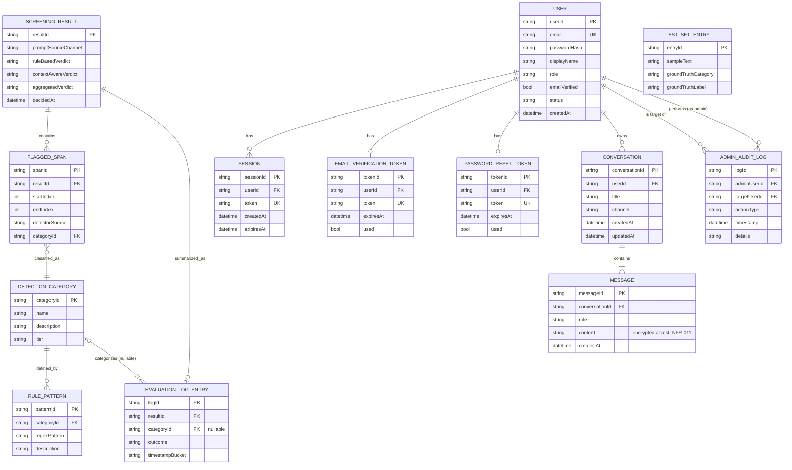

# ERD.md — SentryPrompt4

**Increment:** 5 — Data Model: ERD & AI Data Pipeline
**Traces to:** DOMAIN_MODEL.md (all 14 entities), ../requirements/REQUIREMENTS.md NFR-009, NFR-011, NFR-012, NFR-014
**Note on scope:** this document adds concrete database-level detail (types, keys, constraints) to entities already defined conceptually in DOMAIN_MODEL.md. No new entity or relationship is introduced here that DOMAIN_MODEL.md didn't already specify.

---

## 1. Entity-Relationship Diagram

Per the Database Architect's note above, **`Prompt` is deliberately excluded from this ERD** — it is a transient, in-memory-only object (DOMAIN_MODEL.md §1) and has no corresponding table. Its shape is documented in DOMAIN_MODEL.md and referenced here only as a conceptual source for `Message` and `EvaluationLogEntry`.

**Note:** `TEST_SET_ENTRY` is drawn with no relationship lines to any other entity — this is intentional and mirrors DOMAIN_MODEL.md exactly. It is consumed only by the offline evaluation harness (§3 below), never joined against live tables.

---

## 1A. Physical Mapping on Supabase (PostgreSQL)

The ERD above is the logical model. On Supabase it maps to PostgreSQL as follows:

| Logical entity | Physical location | Notes |
|---|---|---|
| `USER` | `auth.users` (managed by Supabase Auth) + `public.profiles` | `auth.users` holds identity, email, verification state and password hash. `profiles` (same `id`, FK to `auth.users` with `ON DELETE CASCADE`) holds `displayName`, `role`, `status`, `createdAt`. |
| `SESSION`, `EMAIL_VERIFICATION_TOKEN`, `PASSWORD_RESET_TOKEN` | `auth` schema (managed by Supabase Auth) | Not created by us; still shown in the ERD because they are part of the domain model and the deletion cascade. |
| `CONVERSATION`, `MESSAGE`, `ADMIN_AUDIT_LOG` | `public` schema | `conversations.user_id` → `auth.users` and `messages.conversation_id` → `conversations` use `ON DELETE CASCADE` (NFR-014). |
| `SCREENING_RESULT`, `FLAGGED_SPAN`, `EVALUATION_LOG_ENTRY`, `DETECTION_CATEGORY`, `RULE_PATTERN`, `TEST_SET_ENTRY` | `evaluation` schema | Separate schema, no foreign keys to user tables (NFR-009). |

**Types:** IDs are `uuid`; timestamps are `timestamptz`; encrypted message content is `bytea` (NFR-011). Tables are created and changed only through Alembic migrations, so the schema history is version-controlled.

**Access control:** Row Level Security is enabled on every `public` and `evaluation` table with no policies for the public (`anon`) key, so the browser cannot read or write application data directly. All data access goes through the FastAPI backend, which applies the rules in SERVICE_LAYER.md. The frontend talks to Supabase only for sign-in.

**Dashboard visibility:** the project owner can browse every table in the Supabase dashboard. Message content still appears only as ciphertext there, because it is encrypted by the backend before it is written (NFR-011), so the dashboard does not become a back door around NFR-013.

---

## 2. Schema Notes & Constraints

| Table | Key constraints | Rationale |
|---|---|---|
| `USER` | `email` UNIQUE (enforced by Supabase Auth in `auth.users`) | Prevents duplicate registration (FR-013); enforced at the database level, not just application logic. |
| `SESSION` | `token` UNIQUE, index on `expiresAt` | Fast lookup on every authenticated request; supports the idle-timeout check in AUTH_DESIGN.md §3. |
| `EMAIL_VERIFICATION_TOKEN` | `token` UNIQUE | Per Backend Architect's note — a duplicate active token is a defect class, not just an edge case. |
| `PASSWORD_RESET_TOKEN` | `token` UNIQUE | Same reasoning as above. |
| `EVALUATION_LOG_ENTRY` | `categoryId` FK is **nullable** | An "unflagged" outcome has no category to reference — this must be a valid, not a worked-around, state (Security Architect's note above). |
| `MESSAGE` | `content` stored encrypted (application-layer encryption before write, AES-256 per NFR-011) | The database itself stores ciphertext; the encryption key is managed by the Auth/Backend service, not the database layer, so a raw database dump alone does not expose conversation content. |
| `TEST_SET_ENTRY` | No foreign keys to any other table | Structural independence guarantee (DOMAIN_MODEL.md, AI/ML Architect's note above). |
| `ADMIN_AUDIT_LOG` | `adminUserId` and `targetUserId` stored as plain user IDs, **without** foreign keys; **no reference to `MESSAGE` or `CONVERSATION`** | No path from an audit row to conversation content (NFR-013). No foreign keys to users, so deleting an account never alters or removes the audit trail (FR-022 precedence, AUTH_DESIGN.md §8.2). |

---

## 2A. Normalization — Third Normal Form (3NF)

Stated explicitly here since the rubric's B3 criterion (Data/ERD/DFD/Wireframe, 8 marks) requires it named, not just implied by a clean-looking diagram:

- **1NF:** every column holds a single atomic value — no repeating groups or multi-valued fields (e.g. `AdminAuditLog.details` is a single descriptive string per action, not a delimited list of multiple actions).
- **2NF:** every table uses a single-column surrogate primary key (`userId`, `resultId`, `messageId`, etc.), so there is no composite key for a partial-dependency violation to exist against.
- **3NF:** no non-key attribute depends on another non-key attribute. Concretely: `SCREENING_RESULT` stores verdicts and a timestamp, all of which depend only on `resultId`, not on each other; `USER` stores `email`/`passwordHash`/`role`/`status`, each dependent only on `userId`; `CATEGORY`-derived data (`name`, `description`, `tier`) lives once in `DETECTION_CATEGORY` and is referenced by FK from `FLAGGED_SPAN`/`RULE_PATTERN`/`EVALUATION_LOG_ENTRY` rather than duplicated across them — the exact transitive-dependency case 3NF exists to eliminate.

**One deliberate exception, stated rather than hidden:** `SCREENING_RESULT.promptSourceChannel` is a denormalized copy of what would otherwise require joining back through a (non-existent, by design) `Prompt` table — since `Prompt` is explicitly transient/never persisted (DOMAIN_MODEL.md §1), there is no live table to normalize this against. This is a structural consequence of the transient/persisted split already justified elsewhere, not a normalization oversight.

---

## 3. Summary Table — Requirement Coverage

| Requirement | Covered by |
|---|---|
| NFR-009 (no raw content in evaluation logs) | §2 (`EVALUATION_LOG_ENTRY` schema note) |
| NFR-011 (encryption at rest) | §2 (`MESSAGE` schema note) |
| NFR-012 (password hashing) | Handled by Supabase Auth (AUTH_DESIGN.md §0); the application tables never store a password or hash |
| NFR-014 (right to erasure) | `ON DELETE CASCADE` from `auth.users` (§1A), specified in [AUTH_DESIGN.md](AUTH_DESIGN.md) §8.2 |
| FR-011, FR-012 (evaluation logging & independent test harness) | See [DATA_PIPELINE.md](DATA_PIPELINE.md) — the data flow itself is documented there, this ERD only covers the schema it reads/writes |

**Gap closed:** the exact cascade behavior on account/conversation deletion (which rows in `CONVERSATION`, `MESSAGE`, `SESSION`, etc. get removed and in what order) is now specified in AUTH_DESIGN.md §8.2, rather than left as a deferred follow-up.

## Links
- [DOMAIN_MODEL.md](DOMAIN_MODEL.md)
- [AUTH_DESIGN.md](AUTH_DESIGN.md)
- [DATA_PIPELINE.md](DATA_PIPELINE.md)
- [../requirements/REQUIREMENTS.md](../requirements/../requirements/REQUIREMENTS.md)
- [../requirements/PROJECT_BACKLOG.md](../requirements/../requirements/PROJECT_BACKLOG.md)